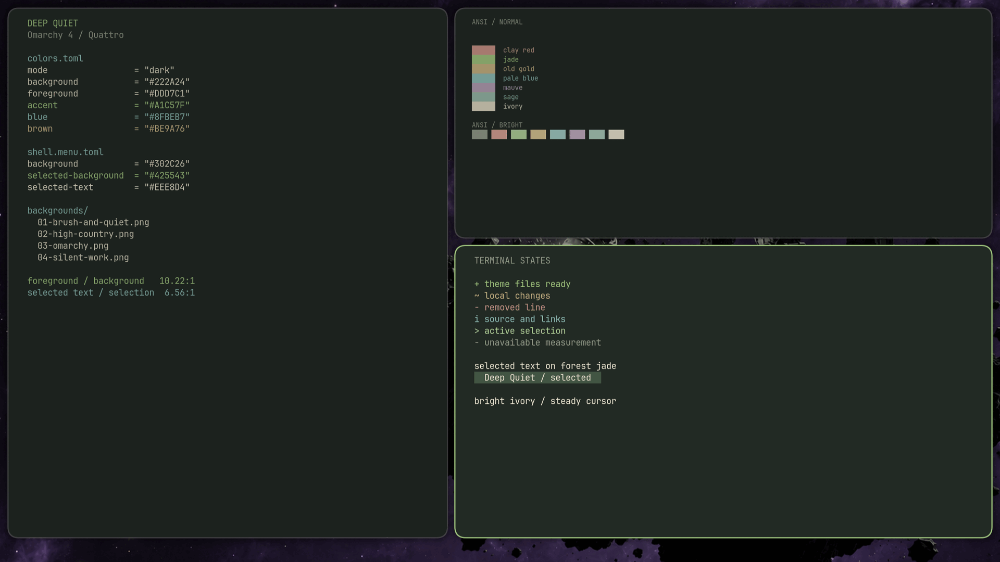

# Deep Quiet

<a href="https://github.com/tcballard/omarchy-badges"></a>


A dark Omarchy theme by Parker Brown, with a forest background, ivory text, jade accents and four wallpapers.



Real desktop capture on Omarchy 4.0.4-1 with Hyprland 0.56.2. The community category badge is not a certification.

## Install

Back up local theme changes and record your current theme and background. This command applies Deep Quiet and can replace an existing installed copy:

```sh
omarchy theme install https://github.com/parker-brown-family/omarchy-deep-quiet-theme
```

To roll back, select your previous theme and background. Switch away from Deep Quiet before removing its installed copy.

## Artwork and License

The four wallpapers are 3840 × 2160 PNGs: three paintings supplied as upscaled exports and one vector-derived Omarchy wordmark. See [artwork sources and permissions](CREDITS.md).

Original theme configuration and supplied original artwork use the [MIT license](LICENSE). Omarchy wordmark geometry retains its [upstream MIT license](LICENSE-OMARCHY).

## Validation

The theme targets Omarchy 4 / Quattro and uses Omarchy's built-in application theming. The separate personal Terminal Delight skin is not included.

[Recorded checks](evidence/checks.tsv) cover the tested installation and specific opaque color pairs. Browser, editor, GTK and lock-screen visual acceptance has not been established.
